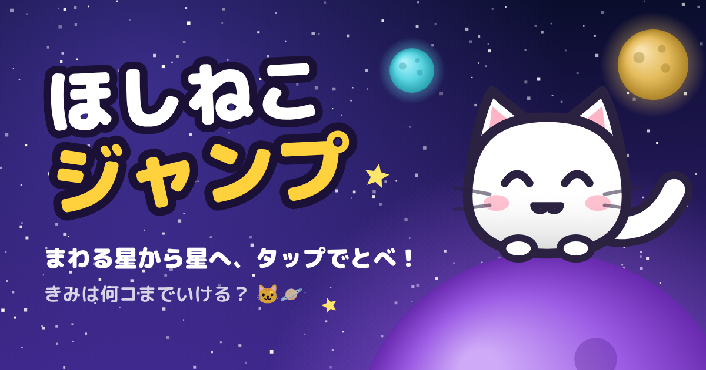

# 🐱🪐 ほしねこジャンプ

まわる星から星へ、**タップでとびうつる**だけの縦画面スマホゲーム。
インストール不要、ブラウザで開いた瞬間に遊べます。



## あそびかた

- 猫は回っている星の上に立っています。**つぎの星の方を向いた瞬間にタップ**でジャンプ。
- 星の**まんなか**に着地すると **PERFECT**。連続PERFECTでコンボ、5連続で **FEVER**（得点アップ）。
- 星に長くいすぎると星がこわれます（リングがタイマー）。
- 星と星のあいだの★を集めると **ねこガチャ** がまわせます（全13種、★3レアあり）。

## バズるための仕掛け

| 仕掛け | 内容 |
| --- | --- |
| 1秒で分かる操作 | タップだけ。最初の3回はガイド付き |
| 「もう1回」 | 1プレイ20〜60秒、リトライ1タップ、「ベストまであと3！」「つぎの称号まであと4！」表示 |
| 気持ちいい演出 | ヒットストップ、画面ゆれ、パーティクル、コンボで音階が上がる効果音、FEVER、振動 |
| 成長と目標 | 7つのゾーン（空の色が変わる）、13段階のおもしろ称号、ねこガチャ |
| 毎日くる理由 | きょうのミッション（毎日3つ・全員共通）、連続ログインボーナス |
| シェア | 結果カード画像（1080×1350）、X / LINE ボタン、Wordle風の絵文字バー |
| 友だちと勝負 | シェアURLに「同じコース＋スコア」が入っていて、開くと「ともだちのスコア42をこえろ！」 |
| デイリー | 「きょうのステージ」は日本時間の日付で全員同じコース |

## 開発

```bash
npm install
npm run dev        # http://localhost:5173
npm run build      # dist/ に出力
npm run sim        # ボットで難易度チェック: npm run sim -- <タイミング誤差秒> <回数>
npm run assets     # アイコンとOGP画像を再生成（dev サーバー起動中に）
```

- `?bot=1` を付けると自動プレイ（デモ・動画撮影用）、`?debug=1` で `window.__game` が使えます。
- 技術: TypeScript + Vite + Canvas 2D（ライブラリなし、JS約24KB gzip）。音はすべて WebAudio で合成。
- `src/core/` はDOMに依存しないゲームロジック（Node でそのままシミュレーションできます）。

## 公開（GitHub Pages）

`main` に push すると `.github/workflows/deploy.yml` が `dist/` を GitHub Pages に公開します。
初回だけ **Settings → Pages → Build and deployment → Source を「GitHub Actions」** にしてください。
公開URL: `https://drean1223.github.io/buzz-mobile-game/`

> 注意: 非公開リポジトリで Pages を使うには GitHub の有料プランが必要です。無料プランの場合はリポジトリを Public にしてください。
